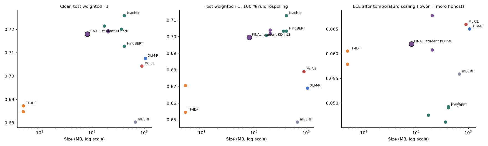

# Robust, Trustworthy and Efficient Hinglish Sentiment Analysis

Course project for **CS-685 (NLP), IIT Mandi**.

Hinglish (Hindi written in Roman script, mixed with English) is how hundreds of millions of people write online, and it has no fixed spelling: *bahut / bohot / bht*, *nahi / nhi*. This project asks:

> **Can a Hinglish sentiment model be accurate, robust to messy spelling and honest about its confidence, and stay that way once it is made small and fast?**

We fine-tune four multilingual encoders on the SemEval-2020 Task 9 (SentiMix) Hinglish data and measure five properties for every model: **accuracy, robustness to respelling, calibration (trust), size and speed**.

## Results



Test set (3,000 tweets). F1 = weighted F1, mean ± std over 3 seeds where shown. *Drop* = F1 points lost when 100 % of eligible Hindi words are respelled (*natural*: real variants mined from the training tweets; *rule*: SMS-style edits never seen in training). ECE = expected calibration error (lower is more honest). AURC = area under the risk–coverage curve (lower = the model knows better when to abstain). CPU ms = median time per tweet at batch size 1 on an Apple M4 Pro, all measured in one session.

| Model | Size | CPU ms | Clean F1 | Natural drop | Rule drop | ECE | ECE after scaling | AURC |
|:--|--:|--:|:--|--:|--:|--:|--:|--:|
| TF-IDF + LR (baseline) | 5 MB | 0.5 | 0.687 | −2.3 | −3.3 | 0.073 | 0.061 | 0.177 |
| TF-IDF + LR + spelling aug. | 5 MB | 0.5 | 0.685 | −0.9 | −1.4 | 0.072 | 0.058 | – |
| mBERT | 679 MB | 21.9 | 0.680 ± 0.015 | −2.1 | −3.2 | 0.039 | 0.056 | 0.180 |
| XLM-R base | 1061 MB | 22.1 | 0.708 ± 0.008 | −2.3 | −3.9 | 0.052 | 0.065 | 0.156 |
| MuRIL | 906 MB | 23.2 | 0.704 ± 0.002 | −2.5 | −2.5 | 0.036 | 0.066 | 0.177 |
| HingBERT | 418 MB | 22.4 | 0.713 ± 0.003 | −1.2 | −0.9 | 0.105 | 0.049 | 0.145 |
| **HingBERT + spelling aug. (teacher)** | 418 MB | 22.6 | **0.726 ± 0.007** | −1.6 | −1.3 | 0.056 | 0.049 | **0.135** |
| Teacher, int8 | 173 MB | 25.6 | 0.721 | −1.8 | −2.1 | 0.035 | 0.048 | 0.143 |
| Teacher, trimmed vocabulary | 367 MB | 17.6 | 0.720 | −2.4 | −1.7 | 0.079 | 0.046 | 0.141 |
| Student 6 layers, no teacher | 205 MB | 8.7 | 0.719 ± 0.007 | −2.0 | −1.7 | 0.023 | 0.068 | 0.149 |
| Student 6 layers, distilled | 205 MB | 9.7 | 0.719 ± 0.006 | −1.4 | −1.5 | 0.057 | 0.061 | 0.146 |
| **Student 6 layers, distilled, int8 (final)** | **81 MB** | 13.0 | 0.718 ± 0.006 | −1.7 | −1.8 | 0.047 | 0.062 | 0.148 |

SemEval-2020 references: official mBERT baseline 0.654; winning system 0.750 (XLM-R large plus extra training tricks).

### Findings

1. **Pre-training on Hinglish matters most.** HingBERT is the most accurate and by far the most robust plain model: it loses about 1 point under heavy respelling, against 2.5–3.9 for XLM-R, MuRIL, mBERT and TF-IDF.
2. **Spelling augmentation** (respelling half the training tweets with real variants) adds +1.3 F1 to HingBERT and halves its overconfidence (ECE 0.105 → 0.056). For TF-IDF it halves the respelling drop.
3. **Temperature scaling is unreliable on this dataset.** It makes three of the four plain transformers *worse* on test, because the validation split is harder than the test split.
4. **Compression costs a little of everything, but not much of anything.** The final model is 5.1× smaller than its teacher (13× smaller than XLM-R) and 1.7× faster on CPU for −0.8 F1, ~0.5 points more respelling drop and +0.013 ECE after scaling. It still beats every plain fine-tuned model. Distillation gives most of the speed-up; int8 shrinks the model but is *not* faster on Apple silicon (PyTorch's qnnpack kernels); on x86 it normally is.
5. **The teacher's guidance does not raise the student's F1** (both students: 0.719). It shows up as steadier training, a smaller respelling drop and better calibration after scaling.

Full write-ups are at the end of each notebook (`04`–`07`).

## Repository layout

```
notebooks/
  01_data_preparation_eda.ipynb      download SemEval-2020 Task 9, clean, fixed split, EDA
  02_baseline_tfidf_calibration.ipynb  TF-IDF + logistic regression baseline; first calibration study
  03_transformers_finetune.ipynb     Experiment 1: mBERT, XLM-R, MuRIL, HingBERT x 3 seeds (GPU)
  04_trustworthy.ipynb               Experiment 3: ECE, reliability, temperature scaling, selective prediction
  05_robust.ipynb                    Experiment 2: respelled test sets, spelling augmentation (GPU)
  06_efficient.ipynb                 Experiment 4: vocab trimming, distillation 12 -> 6 layers, int8 (GPU)
  07_final_comparison.ipynb          one table with all five properties; size/speed timing
src/hinglish/
  data.py          parsing, text normalisation, code-mixing index, splits
  train.py         fine-tuning loop (plain PyTorch), saves result.json + logits.npz
  calibration.py   ECE, reliability diagrams, temperature scaling
  robust.py        mining real spelling variants, rule-based respelling, augmentation
  efficient.py     vocabulary trimming, student construction, distillation, int8, size/latency
scripts/           the GPU-heavy notebook steps as plain scripts (for long runs in the background)
results/           all metrics as CSV/JSON + figures (committed, small)
CS685_*.pptx/pdf   literature review and progress-update slides
```

Not in the repository (regenerated by the notebooks): the dataset (`data/`), trained checkpoints and cached scores (`runs*/`, ~7 GB), and local model copies (`models_hf/`).

## Setup

Tested with Python 3.13 on macOS (Apple M4 Pro, PyTorch MPS). CUDA GPUs and CPU also work; the code picks `cuda` → `mps` → `cpu` automatically.

```bash
git clone <this repo> && cd <repo>
python3 -m venv .venv && .venv/bin/pip install -r requirements.txt
.venv/bin/python -m ipykernel install --user --name hinglish-nlp --display-name "Python (hinglish-nlp)"
.venv/bin/jupyter lab        # open notebooks/, kernel "Python (hinglish-nlp)"
```

Pre-trained models are downloaded from the Hugging Face Hub on first use: `google-bert/bert-base-multilingual-cased`, `FacebookAI/xlm-roberta-base`, `google/muril-base-cased`, `l3cube-pune/hing-bert` (about 3 GB in total).

## Reproducing the results

Run the notebooks in order. Each one skips runs that have already finished, so an interrupted run can simply be restarted.

| Step | Notebook | Needs GPU | Time on an M4 Pro | Produces |
|:--|:--|:--|:--|:--|
| 1 | `01_data_preparation_eda` | no | 1 min | `data/processed/{train,val,test}.jsonl` (14K / 3K / 3K) |
| 2 | `02_baseline_tfidf_calibration` | no | 2 min | `results/02_baseline_tfidf.json` |
| 3 | `03_transformers_finetune` | yes | ~2 h (12 runs) | `runs/<model>/seed<k>/` |
| 4 | `04_trustworthy` | no | 1 min | `results/04_*.csv` (re-run after step 5 to include the augmented model) |
| 5 | `05_robust` | yes | ~45 min (5 runs) | `runs_robust/`, `results/05_*.csv` |
| 6 | `06_efficient` | yes | ~45 min (6 runs) + 10 min CPU scoring | `runs_efficient/`, `results/06_*.csv` |
| 7 | `07_final_comparison` | no | 5 min | `results/07_final_table.csv`, final figure |

The long GPU steps can also run without Jupyter, for example in the background:

```bash
.venv/bin/python scripts/train_transformers.py     # step 3
.venv/bin/python scripts/train_robust.py           # step 5
.venv/bin/python scripts/train_efficient.py        # step 6
```

Then open the notebook for that step; its training cell finds the finished runs and skips them.

**Settings shared by all fine-tuning runs:** learning rate 2e-5 with 10 % warm-up and linear decay, batch 32, 4 epochs, max 128 tokens, best epoch chosen on validation weighted F1, seeds 42/43/44. Distillation: student initialised from teacher layers 0, 2, 4, 6, 8, 10; loss 0.5 × KL to the teacher (temperature 2) + 0.5 × cross-entropy; learning rate 5e-5; 6 epochs.

**Notes on reproducibility:**
- GPU training (especially MPS) is not bit-for-bit deterministic, but re-running a seed gave the same scores to 3–4 decimals in our runs.
- Absolute CPU timings vary by ~30 % between sessions (battery, thermal state); speed ratios between models are stable. Keep the machine on mains power with sleep disabled (`caffeinate -i` on macOS) during long runs.
- Notebook 03 also runs on Google Colab (it mounts Google Drive when it detects Colab).

## Data and references

- **Data:** SemEval-2020 Task 9, *SentiMix* Hinglish (Patwa et al., 2020), [Zenodo record 3974927](https://zenodo.org/records/3974927). Notebook 01 downloads it; it is not redistributed here.
- **Models:** mBERT (Devlin et al., 2019), XLM-R (Conneau et al., 2020), MuRIL (Khanuja et al., 2021), HingBERT (Nayak & Joshi, 2022).
- **Methods:** temperature scaling (Guo et al., 2017), knowledge distillation (Hinton et al., 2015; Sanh et al., 2019), selective prediction / AURC (Geifman & El-Yaniv, 2017).
